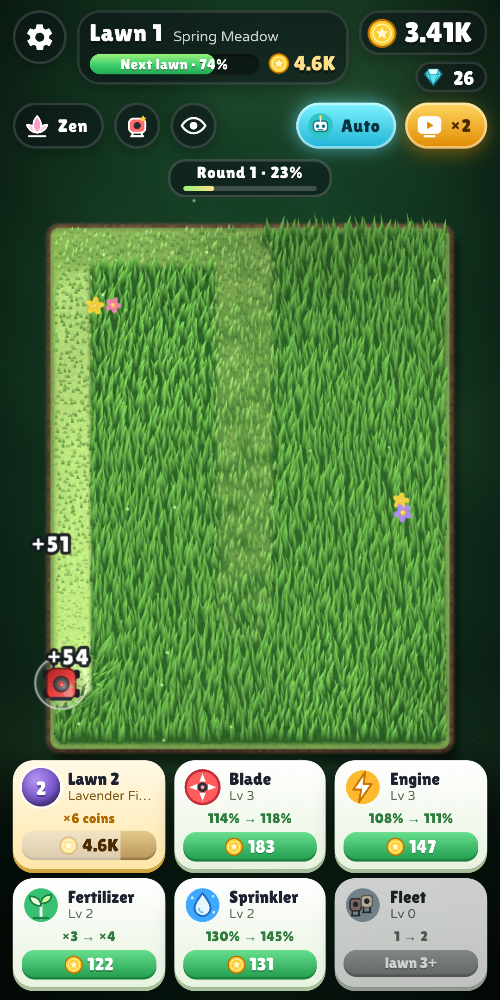
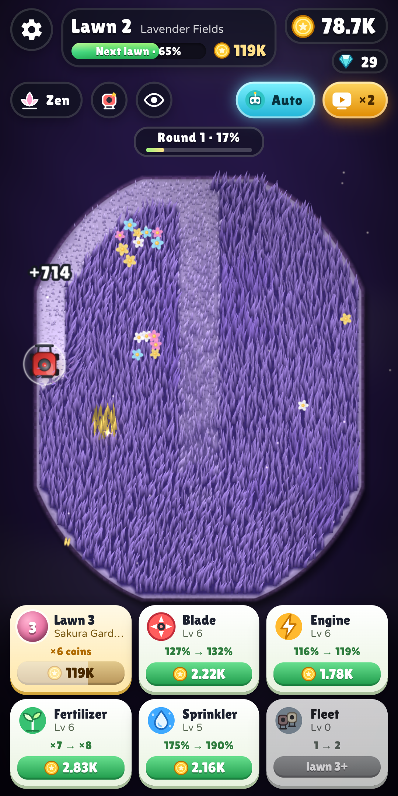
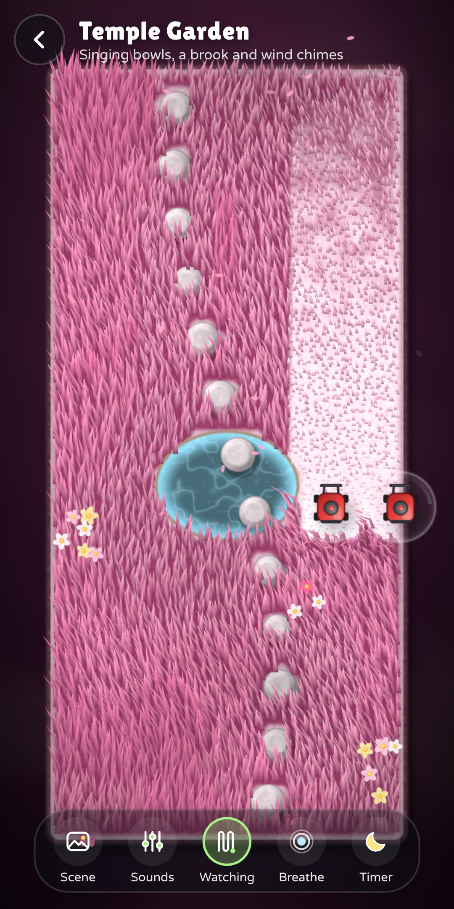
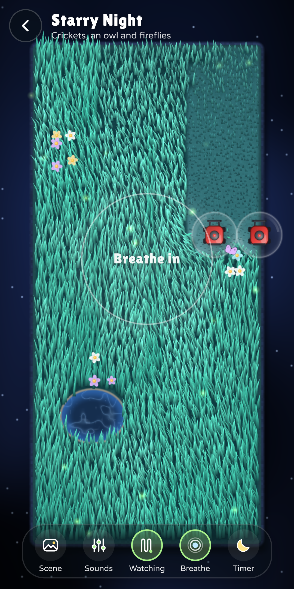

# Zen Mower – relaxing ASMR grass cutting (Android)

A calm, endlessly satisfying lawn-mowing game for Android – inspired by “+1 Cut Grass ASMR”, rebuilt from scratch with bolder visuals, synthesized ASMR audio in perfect harmony, a separate zen mode with nature soundscapes, multi-touch fleets, unlimited procedural levels and AdMob monetization.

<p align="center">
  
  
  
  
</p>

## What's in the game

| | |
|---|---|
| **Grass** | Every blade is GPU-instanced (up to ~17 000 per field) with wind gusts, drifting cloud shadows, blades that bend away from the mower and real lawn stripes in the direction you mowed. Like the original, the lawn **grows back** continuously – you can watch every blade get taller again. |
| **ASMR audio** | 100 % synthesized at runtime (no audio files): granular crunch/snip/rustle grains whose density follows the actual cut rate (energy-normalized, so 4 mowers sound richer but not louder), a soft blade swish, live-generated ambient pads, nature ambience per garden, convolution reverb, a slow glue compressor + limiter. The grass is warm rather than hissy (most energy 300 Hz – 3 kHz, sharpness ≈ 1.6 acum instead of 2.2) and every continuous noise – grass bed, blade swish, wind, rain, brook – is played as random equal-power cross-faded stretches, so nothing is ever heard as a loop (`tools/qa/noisecheck.py`). While you mow you hear grass, nature and pads – pitched notes only mark real events (quarter of a round, round complete, golden patch, upgrades); the mowing melody is optional (settings: off / soft / full). Every bus has a post-fader reverb send, so the volume sliders (master, effects, music, nature) really silence everything; a voice cap drops decorative notes when many sounds overlap. `tools/qa/klongel.py`: ~0.6 pitched attacks/s while mowing vs. 2–2.5/s in 1.1. |
| **Harmony** | Every garden has one key and **every pitched sound uses only its pentatonic scale** – pads, the kalimba melody you "play" while mowing (quantised to the beat), bells, wind chimes, the singing bowl and even the tuned birds, crickets, owl and gulls. A pentatonic scale has no semitones and no tritone, so nothing can clash. Key changes fade out every note of the old key. Verified with `tools/qa/harmony.py` (tonal energy outside the key: 27 % → 0.4 %). |
| **Multi-touch & fleet** | Up to 4 mowers (unlocked on lawns 3, 6 and 10). Extra mowers follow yours in a V formation – or put down more fingers and steer each one yourself. |
| **Autopilot bonus** | A button, not a permanent upgrade: tap it and every mower drives by itself (a bit faster) for 20 s, then it recharges for 2:30 (a rewarded ad recharges it at once). Each upgrade level (one per lawn or so) adds 6 s, up to 80 s. |
| **Rounds** | Mow every spot of the lawn once → **LAWN COMPLETE!** with +50 % of what the round earned, confetti and a fanfare. A pill at the top shows the round's progress, a soft bell marks each quarter, arrows point to the last tufts. |
| **Endless lawns** | As in the original you **buy the next lawn** – its price is always visible next to the progress bar at the top and on the first tile of the upgrade grid. Each lawn pays ×6 per blade, takes the shape of your screen (so it always uses the full width) and is bigger than the last – from 34 to ~100 cells wide – so the growing blade and the fleet always have room; big lawns are drawn "from further away" with larger grass blades, so they look just as lush. Every lawn has its own biome and shape: 14 shapes (heart, star, clover, ring island …) with ponds, stepping stones, flower beds and rocks; 10 biomes, then endless hue-shifted cycles. Thicker multi-layer grass on later lawns. |
| **Progression** | The original's four upgrades – **Blade** (cut size), **Engine** (speed), **Fertilizer** (×(1+level) coins per blade), **Sprinkler** (regrowth speed) – plus **Fleet** and the **Autopilot** duration, all visible at once in a 3×2 grid (no hidden scrolling). Golden patches (×12 + bonus), hidden gems, lucky clovers → frenzy, round bonuses, offline earnings, a daily gift with a 7-day streak, 8 mower skins bought with gems. Prices were tuned with `tools/qa/pace.js`, a bot that plays the real game: ~1.5–2.5 min per lawn at first, ~3–4 min later, upgrade caps around lawn 15 (≈ 45 min), then Fertilizer keeps going forever. |
| **Zen mode** | A separate, endless garden just for relaxing – no coins, no goals. 7 scenes with their own soundscapes: Summer Meadow (breeze, birds, brook), Gentle Rain (rain, distant thunder, visible rain & splashes), Ocean Breeze (waves, gulls), Starry Night (crickets, owl, fireflies), Autumn Wind (gusts, rustling leaves, singing wind tones), Snowy Silence (wind chimes) and Temple Garden (singing bowls, brook, pond with stepping stones). Sound mixer (mowing / wind / water / nature / music), every finger is a mower, autopilot "watch" mode that mows perfect stripes, breathing guide (4-1-6) and a sleep timer that fades out and lets the screen turn off. |
| **Minimal view** | The eye button hides every number and button in the normal game. |
| **Monetization** | AdMob adaptive banner, interstitial only when you move to a new lawn (max every 3 min, never in the first 2 minutes or right after a rewarded ad), rewarded ads (×2 offline earnings, 3-min ×2 cash boost, +5 gems, **30 minutes without ads** in zen mode). Google UMP consent (GDPR/EEA) + “Privacy & ad choices” in settings. |
| **Polish** | English + German (auto by device language), haptics (a fine tick while you cut grass plus pulses for events; off / soft / strong, amplitude-controlled and routed as media vibration so it isn't silenced with touch feedback), adaptive resolution, save/resume mid-level, back-button handling, edge-to-edge/immersive with notch support. |

## Architecture

```
app/src/main/java/…/zenmower/   Kotlin shell: WebView host, JS bridge, AdMob + UMP, haptics, immersive mode
app/src/main/assets/www/        The game: WebGL2 (GL1 fallback) renderer + WebAudio engine, plain JS, no build step
  js/levelgen.js                procedural fields (SDF shapes, distance-encoded terrain)
  js/shaders.js / render.js     grass blades, terrain, sprites, particles, text
  js/game.js                    simulation (mowers, multitouch, formation, cutting, rounds, autopilot, level flow)
  js/audio.js                   ASMR synthesis (grass, instruments, event sounds, master chain)
  js/music.js                   one key per garden: pentatonic harmony, pads, mowing melody
  js/soundscape.js              wind, rain, waves, brook, birds, crickets, owl, chimes, bowl
  js/zen.js                     zen mode (scenes, mixer, autopilot stripes, breathing, sleep timer)
  js/economy.js                 every balancing number lives here
  js/ui.js / css/style.css      HUD, dialogs, shop, settings
store/                          Play Store icon, feature graphic, screenshots, listing texts (EN/DE), data-safety answers
docs/privacy-policy.html        privacy policy to host (e.g. GitHub Pages)
dist/                           prebuilt release APK + AAB (signed with the upload key, Google TEST ad ids)
tools/qa/                       headless-browser QA: pacing bot, screenshots, multitouch & audio checks
```

The game runs fully offline from the APK's assets (served via `WebViewAssetLoader`); only ads use the network.

### Play it in a desktop browser (dev)

```bash
cd app/src/main/assets/www && python3 -m http.server 8765
# open http://localhost:8765 (use devtools device mode for touch). Ads are simulated.
```

## Build

Requirements: JDK 17+ and the Android SDK (platform 36). Toolchain: Gradle 8.14.3 (wrapper), AGP 8.13.2, Kotlin 2.3.21, play-services-ads 25.5.0, UMP 4.0.0, androidx.webkit 1.17.1; minSdk 24, target/compile SDK 36. Then:

```bash
./gradlew assembleRelease bundleRelease   # → app/build/outputs/{apk,bundle}/release/
```

### 1. Your AdMob IDs (required to earn money)

The project – including the prebuilt `dist/` files – uses **Google's official test IDs**, so it is safe to install and test but **earns nothing**. Before publishing, create an app + 3 ad units (Banner/adaptive, Interstitial, Rewarded) in [AdMob](https://admob.google.com) and copy `admob.properties.example` → `admob.properties`:

```properties
ADMOB_APP_ID=ca-app-pub-XXXXXXXXXXXXXXXX~YYYYYYYYYY
ADMOB_BANNER_ID=ca-app-pub-XXXXXXXXXXXXXXXX/1111111111
ADMOB_INTERSTITIAL_ID=ca-app-pub-XXXXXXXXXXXXXXXX/2222222222
ADMOB_REWARDED_ID=ca-app-pub-XXXXXXXXXXXXXXXX/3333333333
```

(or pass them as `-PADMOB_APP_ID=…` / environment variables). A release build with test IDs prints a warning.
Also in AdMob: **Privacy & messaging → GDPR message** (publish it, otherwise EEA users get no consent form), and add `app-ads.txt` to your developer website.

### 2. Signing

Copy `keystore.properties.example` → `keystore.properties` and point it at your upload keystore (never commit it):

```properties
storeFile=/absolute/path/zenmower-upload.jks
storePassword=…
keyAlias=zenmower
keyPassword=…
```

Without it, release builds fall back to the debug key (fine for testing, not for Play).

### 3. CI

`.github/workflows/android.yml` builds APK + AAB on every push. Add repository secrets `ZEN_KEYSTORE_BASE64`, `ZEN_KEYSTORE_PASSWORD`, `ZEN_KEY_ALIAS`, `ZEN_KEY_PASSWORD` (+ optional `ADMOB_*`) to get signed artifacts.

## Release checklist

1. Put your real AdMob IDs in `admob.properties`; publish the GDPR message in AdMob.
2. Change `applicationId` in `app/build.gradle.kts` if you want a different package name (it can never change after the first upload).
3. Host `docs/privacy-policy.html` (fill in your name + contact email) and add the URL in Play Console.
4. `./gradlew bundleRelease` → upload `app-release.aab` (Play App Signing).
5. Store listing: texts in `store/listing.md`, data-safety answers in `store/data-safety.md`, graphics in `store/`.
6. Bump `versionCode`/`versionName` for every update.

## Tuning

All balancing lives in `app/src/main/assets/www/js/economy.js` (upgrade costs/effects, lawn value and price curve, grass thickness) and the ad cadence in `js/main.js` (`ZM.onLevelAdvance`). `tools/qa/pace.js` replays the economy with a bot so you can see minutes-per-lawn before changing numbers.

## Credits

Fonts: [Lilita One](https://fonts.google.com/specimen/Lilita+One) and [Varela Round](https://fonts.google.com/specimen/Varela+Round) – SIL Open Font License (`assets/www/fonts/OFL-*.txt`). All graphics and sounds are generated procedurally by the game's code.
