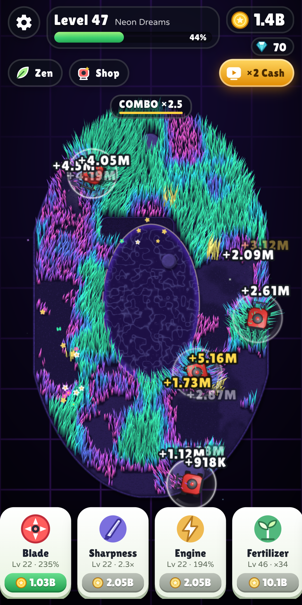
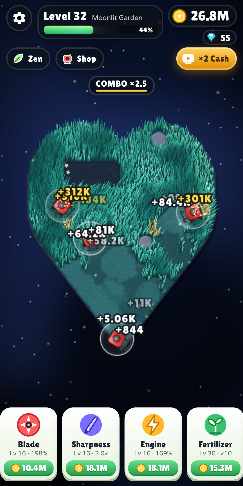

# Zen Mower – relaxing ASMR grass cutting (Android)

A calm, endlessly satisfying lawn-mowing game for Android – inspired by “+1 Cut Grass ASMR”, rebuilt from scratch with bolder visuals, synthesized ASMR audio, multi-touch fleets, unlimited procedural levels and AdMob monetization.

<p align="center">
  
  
  
  
</p>

## What's in the game

| | |
|---|---|
| **Grass** | Every blade is GPU-instanced (up to ~17 000 per field) with wind gusts, drifting cloud shadows, blades that bend away from the mower, real lawn stripes in the direction you mowed, and grass that grows in on every new level. |
| **ASMR audio** | 100 % synthesized at runtime (no audio files): granular crunch/snip/rustle grains whose density follows the actual cut rate, blade whirr, kalimba chimes that always land on the current chord of the live-generated ambient music, nature ambience per biome (birds, crickets, waves, wind, chimes), convolution reverb. |
| **Multi-touch** | Up to 4 mowers – each finger steers its own mower. Autopilot drives the ones you're not steering. |
| **Unlimited levels** | 14 field shapes (heart, star, clover, ring island …) + ponds, stepping stones, flower beds and rocks, procedurally generated per level number. 10 biomes, then endless hue-shifted cycles. Grass gets thicker (up to 12 layers) as you progress. |
| **Progression** | Blade, Sharpness, Engine, Fertilizer, Fleet, Autopilot upgrades; combos up to ×2.5; golden grass ×10; hidden gems; lucky clovers → “frenzy”; offline earnings; 8 mower skins bought with gems. Tuned with an automated bot so levels stay in a ~30–60 s rhythm. |
| **Zen mode** | Endless lawn that keeps growing back – no goals. |
| **Monetization** | AdMob adaptive banner, interstitial (max every 3 levels / 150 s, never in the first 2 minutes or right after a rewarded ad), rewarded ads (×3 level reward, ×2 offline earnings, 3-min ×2 cash boost, +5 gems). Google UMP consent (GDPR/EEA) + “Privacy & ad choices” in settings. |
| **Polish** | English + German (auto by device language), haptics, adaptive resolution, save/resume mid-level, back-button handling, edge-to-edge/immersive with notch support. |

## Architecture

```
app/src/main/java/…/zenmower/   Kotlin shell: WebView host, JS bridge, AdMob + UMP, haptics, immersive mode
app/src/main/assets/www/        The game: WebGL2 (GL1 fallback) renderer + WebAudio engine, plain JS, no build step
  js/levelgen.js                procedural fields (SDF shapes, distance-encoded terrain)
  js/shaders.js / render.js     grass blades, terrain, sprites, particles, text
  js/game.js                    simulation (mowers, multitouch, cutting, combos, autopilot, level flow)
  js/audio.js                   ASMR synthesis + generative music
  js/economy.js                 every balancing number lives here
  js/ui.js / css/style.css      HUD, dialogs, shop, settings
store/                          Play Store icon, feature graphic, screenshots, listing texts (EN/DE), data-safety answers
docs/privacy-policy.html        privacy policy to host (e.g. GitHub Pages)
dist/                           prebuilt release APK + AAB (signed with the upload key, Google TEST ad ids)
tools/qa/                       headless-browser QA: pacing bot, screenshots, multitouch & audio checks
```

The game runs fully offline from the APK's assets (served via `WebViewAssetLoader`); only ads use the network.

### Play it in a desktop browser (dev)

```bash
cd app/src/main/assets/www && python3 -m http.server 8765
# open http://localhost:8765 (use devtools device mode for touch). Ads are simulated.
```

## Build

Requirements: JDK 17+ and the Android SDK (platform 36). Toolchain: Gradle 8.14.3 (wrapper), AGP 8.13.2, Kotlin 2.3.21, play-services-ads 25.5.0, UMP 4.0.0, androidx.webkit 1.17.1; minSdk 24, target/compile SDK 36. Then:

```bash
./gradlew assembleRelease bundleRelease   # → app/build/outputs/{apk,bundle}/release/
```

### 1. Your AdMob IDs (required to earn money)

The project – including the prebuilt `dist/` files – uses **Google's official test IDs**, so it is safe to install and test but **earns nothing**. Before publishing, create an app + 3 ad units (Banner/adaptive, Interstitial, Rewarded) in [AdMob](https://admob.google.com) and copy `admob.properties.example` → `admob.properties`:

```properties
ADMOB_APP_ID=ca-app-pub-XXXXXXXXXXXXXXXX~YYYYYYYYYY
ADMOB_BANNER_ID=ca-app-pub-XXXXXXXXXXXXXXXX/1111111111
ADMOB_INTERSTITIAL_ID=ca-app-pub-XXXXXXXXXXXXXXXX/2222222222
ADMOB_REWARDED_ID=ca-app-pub-XXXXXXXXXXXXXXXX/3333333333
```

(or pass them as `-PADMOB_APP_ID=…` / environment variables). A release build with test IDs prints a warning.
Also in AdMob: **Privacy & messaging → GDPR message** (publish it, otherwise EEA users get no consent form), and add `app-ads.txt` to your developer website.

### 2. Signing

Copy `keystore.properties.example` → `keystore.properties` and point it at your upload keystore (never commit it):

```properties
storeFile=/absolute/path/zenmower-upload.jks
storePassword=…
keyAlias=zenmower
keyPassword=…
```

Without it, release builds fall back to the debug key (fine for testing, not for Play).

### 3. CI

`.github/workflows/android.yml` builds APK + AAB on every push. Add repository secrets `ZEN_KEYSTORE_BASE64`, `ZEN_KEYSTORE_PASSWORD`, `ZEN_KEY_ALIAS`, `ZEN_KEY_PASSWORD` (+ optional `ADMOB_*`) to get signed artifacts.

## Release checklist

1. Put your real AdMob IDs in `admob.properties`; publish the GDPR message in AdMob.
2. Change `applicationId` in `app/build.gradle.kts` if you want a different package name (it can never change after the first upload).
3. Host `docs/privacy-policy.html` (fill in your name + contact email) and add the URL in Play Console.
4. `./gradlew bundleRelease` → upload `app-release.aab` (Play App Signing).
5. Store listing: texts in `store/listing.md`, data-safety answers in `store/data-safety.md`, graphics in `store/`.
6. Bump `versionCode`/`versionName` for every update.

## Tuning

All balancing lives in `app/src/main/assets/www/js/economy.js` (upgrade costs/effects, level value, grass thickness, rewards) and the ad cadence in `js/main.js` (`ZM.onLevelAdvance`).

## Credits

Fonts: [Lilita One](https://fonts.google.com/specimen/Lilita+One) and [Varela Round](https://fonts.google.com/specimen/Varela+Round) – SIL Open Font License (`assets/www/fonts/OFL-*.txt`). All graphics and sounds are generated procedurally by the game's code.
